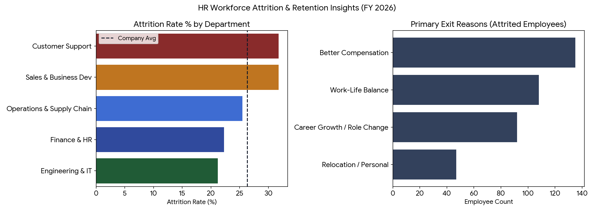

# HR Analytics: Employee Attrition & Retention Dashboard (Excel & Power BI)

[]()
[]()

## Overview
An end-to-end **HR & People Analytics** project built using **Microsoft Excel** and **Power BI** to analyse employee attrition, retention rates, exit drivers, and department-wise workforce trends across **1,450 employees** in five Indian tech hubs (**Bengaluru, Mumbai, Hyderabad, Pune, and Delhi NCR**).

---

## Repository Structure
```text
hr-attrition-retention-analytics/
├── data/
│   └── hr_employee_attrition.csv               # 1,450 employee records with tenure, CTC, satisfaction & exit logs
├── excel/
│   └── HR_Attrition_Retention_Dashboard.xlsx   # Interactive KPI dashboard, department summary & driver tables
├── powerbi/
│   └── HR_DAX_Measures.dax                     # Custom DAX measures for Attrition %, Retention % & Replacement Cost
├── images/
│   └── hr_attrition_overview.png               # Department attrition & exit reason visualization
└── README.md
```

---

## Key Analytical Insights
1. **Departmental Attrition Hotspots:** **Customer Support** and **Sales & Business Dev** exhibit the highest attrition rates, whereas **Engineering & IT** and **Finance & HR** maintain stronger retention.
2. **Overtime & Early-Tenure Burnout:** Employees working regular overtime experience nearly double the attrition rate compared to non-overtime peers, with first-year (`Tenure <= 1 yr`) hires representing a critical onboarding retention window.
3. **Top Exit Drivers:** *Better Compensation* (~38%) and *Work-Life Balance* (~26%) account for nearly two-thirds of voluntary exits.



---

## Excel & Power BI Implementation
- **Excel Model (`excel/HR_Attrition_Retention_Dashboard.xlsx`):**
  - **`Executive_Dashboard`**: KPI summary cards, Department Attrition/Retention table (`COUNTIFS`, `AVERAGEIF`), conditional risk alerts, and embedded charts.
  - **`Attrition_Drivers`**: Overtime impact matrix and office location breakdown.
  - **`HR_Data`**: Clean 1,450-row employee master table.
- **Power BI DAX (`powerbi/HR_DAX_Measures.dax`):**
  - Ready-to-use DAX measures including `Attrition Rate %`, `Retention Rate %`, `Overtime Attrition Rate %`, `Early Tenure Attrition %`, and `Estimated Attrition Replacement Cost (INR)`.

---

## How to Use
1. Open `excel/HR_Attrition_Retention_Dashboard.xlsx` in Microsoft Excel to explore live formulas and charts.
2. Load `data/hr_employee_attrition.csv` into Power BI Desktop, paste the DAX measures from `powerbi/HR_DAX_Measures.dax`, and save your `.pbix` report in `powerbi/`.
